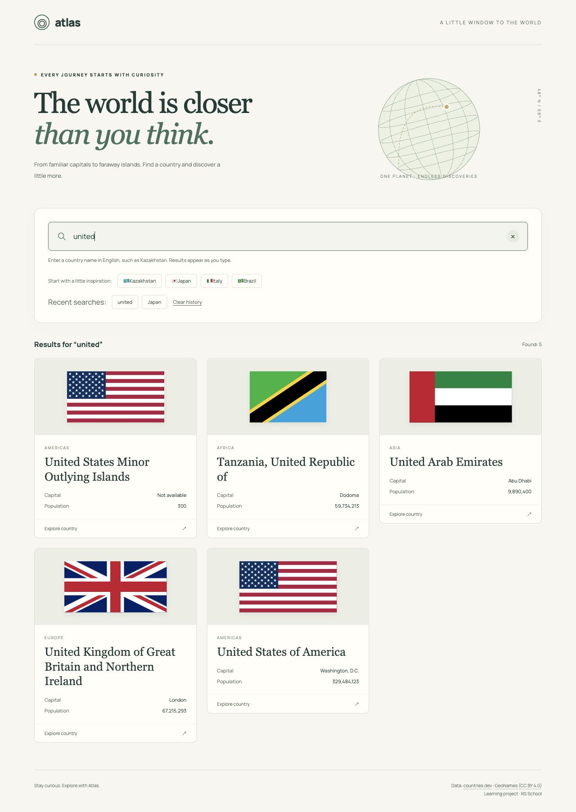

# Country Search

1. Task: https://github.com/rolling-scopes-school/tasks/blob/master/fullstack-engineering/tasks/country-search/README.md
2. Screenshot: 
3. Deploy: https://daniyalbeisenbay.github.io/country-search/
4. Done: **16.11.2026** / Deadline: **17.11.2026**.
5. Self-assessment: **155/155** for the implemented criteria: project setup 15, TDD/tests 30, asynchronous architecture 55, DESIGN.md 20, interface/behavior 25, cache/deduplication 6, history 4. Remaining manual deployment checks are listed below.

## Implementation

English interface and documentation. Live country search with a 300 ms debounce, immediate request cancellation on every input change, a 10-second TimeoutError deadline, HTTP 404 as no matches, HttpError for other non-success responses, and retry of the latest query. Responsive cards and an accessible details dialog. Bounded LRU cache, shared in-flight requests with independent caller cancellation, and localStorage history.

The application is hosted on **GitHub Pages**. The repository and deployment are public. The PR remains open and unmerged.

## Validation

- `npm test`: 39 passing tests.
- `npm run lint`: ESLint and Prettier.
- `npm run build`: strict TypeScript compilation to ES modules.
- Test-first commit pairs: [TDD.md](https://github.com/DaniyalBeisenbay/country-search/blob/country-search/TDD.md).
- Separate request-race test: commit `378305c`. Its fetch mock rejects with AbortError when its signal is aborted and schedules the earlier response after the later one.
- Architecture and complexity: [DESIGN.md](https://github.com/DaniyalBeisenbay/country-search/blob/country-search/DESIGN.md).

## Behavior checklist

Items distinguish automated evidence from manual browser verification. The two unchecked DevTools checks remain for final manual review.

- [x] Empty input makes no requests and clears results: API, controller, and race tests.
- [x] A loading indicator appears during a request: browser verification.
- [x] Fast input cannot display an outdated result: inverted response-order race test with real signal cancellation.
- [ ] Verify canceled/aborted requests in the Network panel under throttling on the deployment.
- [x] Caller cancellation never appears as an error: controller and race tests.
- [x] A search with no matches displays a friendly empty state: browser verification using `zzzz-no-country`.
- [x] Genuine HTTP, network, and timeout errors offer retry of the latest query: mocked error tests.
- [ ] Manually disconnect the network and verify the Retry button on the deployment.
- [x] Clicking a card opens country details: browser verification with Japan.
- [x] Responsive layout: browser verification at a 390 px width.
- [x] Cache, deduplication, and independent subscriber cancellation: unit tests.
- [x] History and immediate repeated search: unit tests and browser verification.
- [x] Public deployment is available without signing in.

## Submission

Implementation is on `country-search`; `main` contains only README and `.gitignore`. `gh-pages` contains deployment assets. The repository is public at the author's request. Preserve the TDD commits, leave this PR unmerged, and submit its URL through RS App → Cross-Check: Submit.
